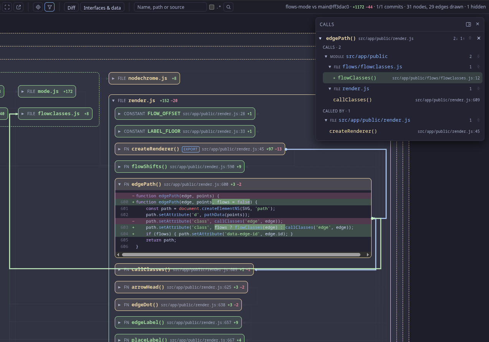

# srcblocks

srcblocks is a local-first, offline web app for exploring a source tree and
changes to it as a graph: every module, file, class and function is a block on
a canvas, and the calls between them are the lines.

This is my first, vibe coded attempt at using LLMs to simplify the process of
reviewing large, LLM-generated changesets. It turned out to be useful for
general navigation and exploration of a repository too. It includes UI
functionality I wish GitHub had.

Point it at a git repository and it draws the call graph of the default branch's
JavaScript and TypeScript code. Directories hold files, files hold classes and
functions, classes hold their methods, and every block opens and closes. An open
function shows its source, highlighted, with its documentation and the line
numbers it has in its file. Arrows indicate referenced nodes or nodes that
reference the current node.

Pick a branch and its changes are drawn over the graph: what it adds in green,
what it changes in yellow, what it removes in red, calls included. Its commits
are listed beside the canvas, all of them ticked; untick some and the canvas
shows the branch without them.



## Features

- A call graph of modules, files, classes, functions and constants, nested as
  blocks, with each call drawn to the most specific block that is open.
- A branch's added, changed and removed functions, constants and calls coloured
  on the canvas, for any selection of its commits.
- A branch stacked on another is compared with the branch below it, and any
  other branch can be chosen as the base instead.
- Every block's header counts the lines the branch changed in it (`+12 −3`),
  summed through classes, files and modules.
- Diffs of a function, a file, a module or the whole branch, in one column or
  two, with the changed words inside an edited line marked.
- Any file opened whole over the canvas, as it stands or as the branch changed
  it.
- From any changed line to the commit that wrote it, its message first.
- What a function calls and what calls it, in a window that keeps the trail
  followed so far; the browser's Back button walks it in reverse.
- *Interfaces & data*: the branch's changed signatures, exports, types and data
  structures, without the function bodies.
- Ctrl-click a name in a function's source to go to its definition.
- Search names, paths and source, as plain text or a regular expression.
- Hide, pin and drag blocks; show only what the branch touched, or only what is
  exported.
- Twelve colour themes.
- Copy a block's location (`+42 src/file.js`) to open it in an editor.
- Offline and read-only: the analysis runs locally, and the repository is never
  modified.

## Known limitations

- Only JavaScript and TypeScript: `.js`, `.jsx`, `.mjs`, `.cjs`, `.ts`, `.tsx`,
  `.mts` and `.cts`. `node_modules`, `dist`, `build`, `out`, `coverage` and
  dot-directories are skipped.
- Only committed state. Uncommitted changes in the working tree are part of no
  revision and never appear, and a file opened in a window is the file as
  committed.
- A conflict resolution made inside a merge commit is invisible, since merge
  commits are skipped; see [How branches are compared](#how-branches-are-compared).
- A call the TypeScript checker cannot resolve to a declaration draws no edge:
  dynamic dispatch (`handlers[name]()`) or a method called on a value the
  checker cannot type. Calls into packages and globals are not drawn either.
- Object-literal methods (`export const api = { run() {} }`) and functions built
  at runtime get no nodes. Nested and anonymous functions are folded into the
  nearest named declaration above them: their calls are drawn from it, and a
  call to one of them is not drawn at all.
- An interface's method signatures are not linked to the methods that implement
  them.
- A node is identified by its file and qualified name, so a rename, or a moved
  file, reads as a removal plus an addition.
- A function is changed when its documentation or source differs, ignoring only
  trailing whitespace, so reformatting it counts as a change.
- A test with a computed name is left out of its suite.
- Go-to-definition works in the source on the canvas only, not in the file and
  diff windows, and only for names declared in the analysed files.

## Running it

### Requirements

- Node 22.12 or later
- git 2.24 or later, and `tar`
- A POSIX system - Linux or macOS; on Windows, use WSL. `bin/srcblocks` is a
  bash script, and revisions are unpacked through `sh`.

### Starting it

```sh
git clone https://github.com/walterl/srcblocks.git
cd srcblocks
npm ci
npm link                       # or put srcblocks/bin on your PATH
srcblocks /path/to/your/repo   # add --include src to draw only src/
# open http://127.0.0.1:4173
```

`srcblocks` with no repository draws the current directory. The same server
can be started from the checkout with its settings in the environment:

```sh
SRCBLOCKS_REPO=/path/to/your/repo SRCBLOCKS_INCLUDE=src npm start
```

| Variable              | Default                                              | Meaning                                                                                                                                                                                                                                                                                                  |
| --------------------- | ---------------------------------------------------- | -------------------------------------------------------------------------------------------------------------------------------------------------------------------------------------------------------------------------------------------------------------------------------------------------------- |
| `SRCBLOCKS_REPO`      | current directory                                    | The git repository to navigate. It is only ever read, never written to.                                                                                                                                                                                                                                  |
| `SRCBLOCKS_INCLUDE`   | *(everything)*                                       | Comma-separated path prefixes to draw, e.g. `src`. Files outside them are still parsed so calls into them resolve, but they get no nodes.                                                                                                                                                                |
| `SRCBLOCKS_CACHE_DIR` | `$XDG_CACHE_HOME/srcblocks`, or `~/.cache/srcblocks` | Where extracted revisions and analysed graphs are cached.                                                                                                                                                                                                                                                |
| `SRCBLOCKS_SERVICES`  | *(none)*                                             | Comma-separated package names to count as services (packages that reach outside the process), beside the built-in list in `src/analyze/externals.js`. Packages are not drawn on the canvas, so this only shows in `npm run analyze` and in the graph `/api/graph` returns for a revision not yet cached. |
| `PORT`, `HOST`        | `4173`, `127.0.0.1`                                  | Where the UI is served.                                                                                                                                                                                                                                                                                  |

There is no authentication. By default the server only answers requests
addressed to localhost on its own port; setting `HOST` to anything but a
loopback address hands the whole repository, source and history, to anyone
who can reach that port.

The app is offline in the strict sense: its one browser dependency (highlight.js,
for syntax colouring) is served from `node_modules`, and the analysis runs
locally against a git repository on disk.

### Development

See [CONTRIBUTING.md](CONTRIBUTING.md) for the tests, the browser tools and
how commits are written.

## Guide

### The canvas

- The canvas opens on the default branch with the outermost modules expanded.
  Click a module, file or class to open it; click a function to show its source,
  with line numbers from the file it came from. What a file or class contains is
  stacked in the order it is written; what a module holds is packed into columns
  of roughly equal height, tallest first. Functions exported from their module
  carry an `export` tag; with a branch loaded it is green where the branch
  started exporting the function and red, struck through, where it stopped.
- Everything a node offers lives in a **menu that opens when the pointer rests
  on its header**, flush against the row so the name stays readable and there is
  no canvas in between to cross on the way to it. It is drawn at the screen's
  size rather than the canvas's, so the buttons stay legible and clickable
  however far the canvas is zoomed out; the pointer can travel from the header
  into the menu without it disappearing, and pressing, scrolling or dragging the
  canvas - or opening a window - puts it away.
- The toolbar at the top carries what acts on the canvas, as icons named by
  their tooltips: expand and collapse everything, close every open source, frame
  everything, show only what is exported, and - once a branch is loaded - reopen
  the canvas on the current diff, show only what the branch touched, and the
  `Diff` and `Interfaces & data` windows.
- **Reopen the canvas on the current diff** closes everything and reopens only
  what the selected commits touch - the view a branch opens with. Ticking
  commits changes what that is, so it is worth a button.
- **Close every open source** folds away every open function body without
  touching which modules, files and classes are open - the tree stays where you
  put it.
- **Show only what the branch touched** takes everything the branch left alone
  off the canvas, leaving the touched functions, the containers holding them,
  and the calls between what remains.
- **Show only what is exported** narrows every module and file to the
  declarations that carry an `export` tag - the public interface of the whole
  tree, and what the branch did to it. A declaration the branch stopped
  exporting stays, since that too is a change to the interface. The same button
  in a module's or file's menu narrows just that one, and opens it back up while
  the toolbar's is on.
- Drag the background to pan, scroll to zoom, **Frame everything** to fit it all
  in view. Expanding or collapsing keeps the node you clicked under the pointer.
  The button at the left of the status bar folds the sidebar away when the
  canvas needs the whole window.
- The wheel scrolls an open function's source while the pointer is over it, and
  zooms the canvas everywhere else.
- Drag a node by its header to move it - handy for pulling a function out of a
  crowded file. Whatever holds it grows or shrinks to wrap it, its neighbours
  move out of the way rather than being covered, and a container takes its
  contents with it. Positions survive expanding and collapsing, and reset when
  another branch is analysed.
- The eye in a node's menu **hides** it. A hidden node is drawn shut
  and faint, and stops counting for everything else: what it holds leaves the
  canvas, the calls at either end of it are not drawn, no calls list mentions
  it, search steps over it, and a file whose only changes were inside it drops
  out of the Files section. The same button brings it back exactly as it was -
  which is what makes it worth hiding a noisy module while reading around it.
- The pin at the end of the menu **pins** the node: its calls stay
  highlighted, and everything else stays dimmed, while you look elsewhere.
  Hovering any node highlights its calls the same way, without pinning.
- Highlighted edges are drawn **over** the nodes rather than under them, and a
  dot marks the end each call leaves from - so an edge that ends at a node can
  be told from one that only passes beneath it. They step around any open
  source on the way: a call you are following never lies across the code you
  are following it into.
- Resting the pointer on a module, file or class header explains it: its full
  path in the repository, what it holds, and how much of that the branch adds,
  changes or removes.

### Branches and commits

- Pick a branch in the sidebar to overlay its changes. A branch stacked on
  another is compared against the branch below it, so it shows its own work
  rather than the whole stack's. `Diff against` under the branch list offers
  every other branch the branch has commits beyond, nearest first - the rest of
  the stack, then everything else, with a filter for the long tail - if you want
  to see further down. Reading a branch means parsing every revision it touches,
  which is seconds of work the first time: a spinner over the canvas says so,
  and the branch pickers are held shut until it is done. Every container holding
  a change is opened automatically, and the commit list appears with all commits
  selected. The branch section then folds itself away, leaving the branch it
  chose on one line; open it again to untick commits, copy a hash, or read a
  whole commit message from a row's tooltip. The sidebar is an accordion: what
  is open takes the room the folded sections are not using and scrolls inside
  itself, so folding the branch away gives the file tree the whole window.
- With a branch loaded every node's header ends with **how many lines the branch
  changed in it** - `+12 −3`, the way a diff reports it. A function counts its
  own diff; a class, file or module counts everything it holds, so a folded file
  says how much of it moved before you open it. It counts what the canvas shows,
  which is what the commit selection shows, so it agrees with the colours around
  it. What a file changed outside its declarations - an import, a comment
  between two functions - is in the file's own diff instead.
- Open a changed function while a branch is selected and its source is shown as
  a diff against the base revision, line by line. `split` in its menu puts the
  two revisions side by side, `inline` brings them back into one column. Inside
  a line that was edited rather than added or removed, the words that changed
  are marked. A yellow bar next to the documentation means the documentation is
  what changed.
- Source is read eighty columns wide, and each side of a `split` gets its own
  eighty: a long line scrolls its own column rather than pushing the other side
  off the end of the node, and the two are kept level as they move, since a diff
  is read across. In a window there is more room, so each side takes half of it.
- Hovering a changed line offers the commit that wrote it, at the end of the
  line. Clicking it opens that commit on its own - **its message first**, then
  everything it changed - which is usually where the answer to "why was this
  change made?" is written. Both sides of a diff answer: a new line names the
  commit that wrote it, a removed line the one that wrote what is being taken
  away. Links show wherever a diff is drawn: in a function on the canvas, in a
  maximised one, in a file's diff, and in the diff window.

### Windows

- `Diff` in the toolbar opens the whole of the loaded diff in one
  window: every changed function, grouped by file, with its lines. A hunk's
  heading is a link - following it closes the window and takes the canvas to
  that function.
- A changed node carries a `diff` button in its menu: a function opens its own
  hunk, a file, a class or a module opens the diff of the files themselves - imports and
  all, not only what the canvas has nodes for. It is the way to see a change the canvas cannot show - a rewritten
  comment, or a body that came back to what it was. For a module that diff is
  the whole of what it holds, file by file, and it is the only window a module
  has.
- `⤢` in a node's menu **opens the file it lives in, over the canvas**: a
  declaration's file opened at the declaration, a class's at its methods, a
  file's at the top. The window is as wide as the code in it and no wider, between
  eighty columns and the width of the canvas, and centred on it, so a file of
  short lines leaves the canvas it came from in view on either side; a diff shown in two columns splits that width evenly,
  since two columns of different widths do not line up to be read across. The node's own lines stay marked in the page, so
  it is clear which part of the file you came for - the imports above it and the
  helper below it are the context a node on its own cannot give. The calls list
  stays on top of it, so a function can be read in full and followed at the same
  time. `Escape` closes it. A module is a directory rather than anything with a
  file behind it, so it has no `⤢`; its `diff` button is what it has instead.
- `DIFF` in the window's header says what the lines are. **Off**, they are the
  file as it stands under the current commit selection - the code that actually
  runs. **On**, they are what the branch did to the file, whole: every line of
  it with the removals still among them, in one column or two, blame links and
  all. Whole rather than hunked, because what surrounds a change is exactly what
  a reader who asked for the file came for - a change the canvas has no node
  for, an import or a comment between two functions, is only legible among the
  lines around it. What it takes to ask is a diff being loaded, not this file
  being in it: most of the files a diff is read against are untouched, and
  asking what happened to one of them is a fair question with `nothing` for an
  answer. With no diff loaded at all there is nothing it could show, and it says
  so by being dead.
- The header carries all of that at its left end, beside the path and the lines:
  how many lines the diff added and removed in the file, `DIFF`, and - while a
  diff is what is being read - `INLINE`/`SPLIT`. The count is of the lines the
  window has, so it says the same thing the page below it does, and it is said
  whichever way `DIFF` is set: what the diff did to the file is a fact about the
  file either way. A file the branch left alone says so by
  saying nothing, which for most of the files a branch is read against is the
  whole truth. The node's own buttons stay on the canvas, where they mean
  something: hiding a node or pinning its calls is about a canvas the window is
  covering.
- `Interfaces & data` answers "what changed" without the "how": signatures,
  exports, types and the structures a module declares - a changed signature
  shown as its old and new form, a changed structure as the parts that came and
  went. A function whose body was rewritten but whose signature still reads the
  same is not in the list, and neither is a scalar whose value moved. The two
  toggles hide either type, and clicking an item takes the canvas to it.
- `Escape` closes the diff window. The calls list, search results and change
  list are how you move around, so they stay put until closed or replaced.

### Finding your way

- The sidebar's **Files** section lists what is on the canvas as a tree of
  directories - every analysed file, or with a branch loaded only the files it
  touches, coloured by what happened to them. Clicking one takes the canvas to
  that file.
- With a branch loaded each file opens to show what the diff touched inside it:
  the changed functions and constants, and the classes holding the methods that
  changed, in source order and coloured the same way - a review list in the
  order the code is written. Clicking one takes the canvas to it; the chevron
  folds a file away again. With no branch loaded nothing is touched, so the
  files stay closed.
- **Expand all** and **Collapse all** above the tree do the whole of it at once,
  for arriving at a repository of a hundred and fifty files. Neither offers what
  has already been done.
- **Search** in the toolbar matches module and file names, class and function
  names, repo-relative paths, and the source of every function on the canvas -
  as plain text or, with `.*` ticked, as a regular expression. Results say
  where they matched and, for a match inside a function, quote the line; click
  one to jump to it.
- Clicking a function selects it, and hovering or pinning one selects it too:
  the window beside the canvas lists what each selected function calls *and*
  what calls it, a group per function, newest on top and open with the rest
  collapsed underneath.
- An entry reads like a diff line: a green row with a `+` for a call the shown
  revision makes and the base did not, a red row with a `−` for one it no longer
  makes. The name keeps the canvas colours - green for a function the branch
  adds, yellow for one it changes, red for one it removes - so a removed call to
  a rewritten function shows both at once.
- Click an entry to open whatever hides that callee, open its source and flash
  it. The canvas flies there rather than cutting, dipping the zoom out on a long
  trip so you can see where you went; grabbing the canvas ends the flight, and a
  system "reduce motion" setting turns it into a jump. The function you came
  from stays in the list, collapsed, so the window reads as a breadcrumb: expand
  any earlier step to follow one of *its* other calls, click a group's header to
  jump back to it, or use the browser's Back button to walk the trail in
  reverse. The button beside the window's ✕ docks it down the right of the
  canvas, full height, instead of floating over the nodes.
- Clicking another node starts a fresh trail; clicking the background - the
  canvas between the nodes, or the space between the functions in a file - ends
  it. A group's ✕ drops just that function, and closing the window drops the lot.
  A pin outlives all of that, which is what pins are for.
- Hold **ctrl** over an open function's source and every name defined in the
  tree - a function, a class, a type, a constant, a local - reads as a link.
  **Ctrl-click** one to go to its definition: the canvas opens whatever hides it
  and flies there, to the line itself for a local or a parameter. A node hidden
  with the eye, or left out by **Show only what the branch touched**, is put
  back for it. A name declared outside any node - a binding destructured at the
  top of a file - opens its file in the window at that line. Names from
  packages, the platform or files outside `SRCBLOCKS_INCLUDE` are not links.
  Back returns to where the click came from.
- The clipboard button in any node's menu copies **where it is**, in the form
  an editor takes: `+53 src/app/api.js` for a declaration, the plain
  path for a file or a directory. Paste it after vim's `:edit ` and the file
  opens on that line - reading happens here, editing happens there, and this is
  the shortest way between them.

### Appearance

- The **theme** is chosen at the foot of the sidebar, and remembered. The canvas
  opens in `Catppuccin Mocha`. Six were drawn for it - `Classic`, the GitHub-dark
  palette it wore first, `Terminal` in phosphor green, `Amber` behind CRT
  scanlines, `Ink` with hue reserved entirely for the diff, `High contrast`, and
  `Paper` for daylight - and the rest are palettes people already read code in:
  Solarized Dark and Light, Gruvbox, Nord and Dracula.
- Whichever is chosen, **source is read on a surface of its own**: the shade of
  the node it sits in and the wash that says the branch touched it stop at the
  code, so the only colours behind a line are the diff's.

## How it works

### Reading a repository

- The repository is chosen when the server starts - `SRCBLOCKS_REPO`, or the
  `srcblocks` command's argument - not from the browser, and it is never
  modified. Each revision is read with `git archive <rev> | tar -x` into
  `trees/<tree-sha>/` under the cache directory: no checkout, no worktree, no
  change to the index.
- Analysed graphs are cached by git tree SHA and by a hash of the analyser's
  own source, so re-opening a branch is instant, two branches sharing history
  share their work, and a change to the analyser retires the graphs it wrote
  before.
- Reading a branch parses every revision on it, plus the base, so the first
  time takes seconds for an ordinary feature branch; after that it is cached.
- Every extracted revision stays in the cache as a full copy of the tree.
  Delete the cache directory (see `SRCBLOCKS_CACHE_DIR` under
  [Starting it](#starting-it)) to reclaim the space; it is filled again as
  needed.

### How branches are compared

- With no branch picked, the canvas shows the default branch: `origin/HEAD` if
  it is set, otherwise the first of `main`, `master`, `origin/main` and
  `origin/master` that exists.
- A picked branch is compared with the remote copy of the default branch
  (`origin/main` when the default is `main`), or with the local one when there
  is no remote copy - unless it is stacked. If another branch's tip is in this
  branch's history but not in the default branch's, the branch is stacked on
  it, and the nearest such branch is the base, so the canvas shows this
  branch's own work rather than the whole stack's. The default branch itself is
  compared with the nearest branch it has commits beyond.
- `Diff against` offers every other branch the branch has commits beyond,
  nearest first. A branch this one is simply ahead of comes before one that has
  since gone its own way, since that one's own work would show up as removals.
- The comparison point is `git merge-base <base> <branch>`, so what the base did
  in the meantime is left out.
- Merge commits are skipped, and every other commit is diffed against its own
  first parent. A merge measured against its first parent would report
  everything the other side brought as its own work; what that side did is in
  its own commits, which are listed whenever the base does not already have
  them.
- Each commit's diff is independent of the others, so ticking commits folds
  their diffs together in commit order without re-analysing anything. Added
  then changed stays added; added then removed disappears; removed then added
  again is changed; anything then removed is removed.
- What is drawn is a state, "the base plus these commits", so a function that
  one selected commit changed and another changed back is not coloured, and a
  function's diff is always against the base, not the previous commit. Calls
  are compared the same way: the base's against those of the revision on
  screen. A call that the shown revision makes brings its callee onto the
  canvas, even when the commit that added the callee is unticked.

### What becomes a node

- A **module** is a directory, and nested directories nest.
- A **class** or an interface holds its methods, accessors, constructor and
  arrow-function fields.
- A **function** is a function declaration, a class member, or a
  `const f = () => {}` / `const f = function () {}` at file or namespace level.
- A **constant** is a type alias, an enum, or a top-level binding whose value is
  not a function, exported or not. It has source and a diff like a function,
  but it calls nothing and is never a call's target. A function that reads or
  writes another file's exported constant is joined to it by a dotted edge
  instead, listed in the calls window as `reads` or `writes`.
- In a test file, `describe` becomes a group and the `test`, `it` and hook
  calls inside it its members, labelled by their description. What a test
  calls is an edge like any other, so a function's callers include the tests
  that exercise it.
- Calls are resolved with the TypeScript type checker, which works for plain
  JavaScript too: `this.x()`, `super.x()` and imported functions all reach the
  declaration they call. `new Foo()` points at `Foo`'s constructor, or at the
  class when it declares none. A self-edge is drawn only for recursion.
- An edge that stands for several calls is coloured only when every one of them
  changed the same way. A container is coloured as changed when anything in it
  is, unless it was added or removed itself.

### Code layout

```
git archive <rev> ──▶ <cache>/trees/<tree-sha>/ ──▶ TypeScript program
                                                        │
                              call graph (modules, files, classes, functions, call edges)
                                                        │
              base revision + one graph per commit ──▶ per-commit diffs + union graph
                                                        │
                                                    /api/branch
                                                        │
   commit selection ──▶ node/edge status ──▶ expand state ──▶ edge re-pointing ──▶ packing ──▶ DOM + SVG
```

| Layer | Files |
| ----- | ----- |
| Parsing and graph building | `src/analyze/program.js`, `collect.js` (declarations, data and test suites), `calls.js`, `graph.js` |
| Revisions, diffs, branches | `src/analyze/revision.js`, `diff.js`, `branch.js`, `src/git/repo.js` |
| HTTP | `src/app/server.js`, `src/app/api.js` |
| Canvas | `src/app/public/model.js` (status folding, call queries), `viewmodel.js` (what is drawn, edge re-pointing), `layout.js` (packing and stacking), `render.js` (DOM + SVG), `selection.js` (what is selected), `calls.js` (calls window), `code.js` / `diff-lines.js` (source and diffs), `viewport.js` (pan/zoom), `app.js` (state) |
| Carried types and boundaries | `src/analyze/flows.js` (carried types, members, access edges), `externals.js` (what is a service) |

Endpoints: `GET /api/repo`, `GET /api/graph?ref=<ref>`,
`GET /api/branch?name=<branch>[&base=<ref>]`, `GET /api/file?path=<path>&ref=<ref>[&base=<ref>]`,
`GET /api/file-diff?path=<path>&base=<ref>&head=<ref>`, `GET /api/blame?path=<path>&ref=<ref>`
and `GET /api/commit?sha=<sha>`.

## License

[](./LICENSE.md "GPLv3")
